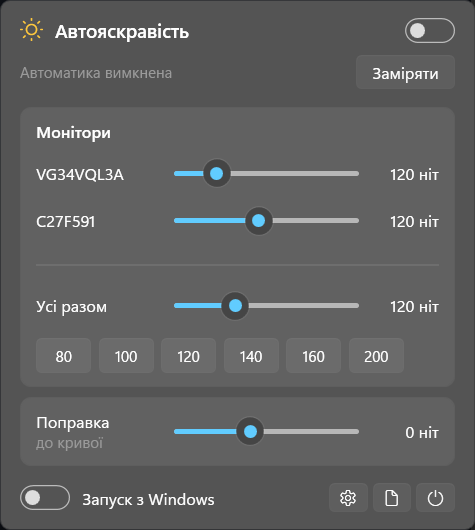
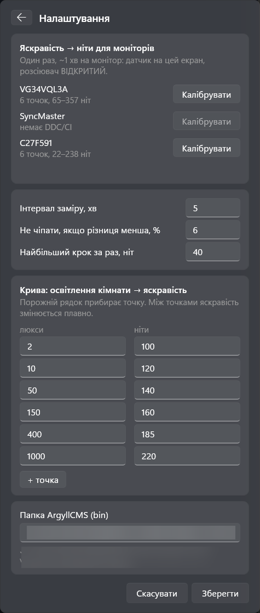

<p align="center"></p>

<h1 align="center">AmbientLightCalibrate</h1>

<p align="center">
<b>Automatic monitor brightness from real room light, measured with a colorimeter.</b><br>
A tiny Windows 11 tray app: your i1Display / ColorMunki sits next to the screen, measures the room in lux
every 30 seconds, and AmbientLightCalibrate sets every monitor to the right brightness in <b>nits</b> over DDC/CI.
</p>

<p align="center">
<a href="https://github.com/AndriyOrlov/AmbientLightCalibrate/releases/latest"></a>
<a href="LICENSE"></a>


</p>

<p align="center">

&nbsp;&nbsp;

</p>
<p align="center"><sub>Tray flyout and settings (Ukrainian UI shown; the app is in English on non-Ukrainian Windows).</sub></p>

---

## Why

Phones and laptops dim and brighten with the room; desktop monitors don't. Calibration tools such as
Calibrite PROFILER can *measure* ambient light and *suggest* a brightness, but they don't keep adjusting it.
AmbientLightCalibrate does — with real numbers instead of guesses:

* **Measures, not estimates.** Room light comes from your colorimeter's ambient diffuser (lux), and every monitor's
  brightness is mapped to measured luminance (nits), so two different monitors land on the *same* nits.
* **Keeps your calibration.** Only the backlight (DDC/CI VCP 0x10) is changed — never RGB gains, never the video LUT.
  White point and gamma of a calibrated LCD stay put.
* **Quick and calm.** A light switched on or off is followed within one reading, with a one-second fade; a dead zone keeps it from twitching. The sliders move live while it adjusts.
* **Safe.** Leaves a monitor alone while it is in **HDR** (HDR wants full backlight), and pauses while DisplayCAL,
  ArgyllCMS, HDRDisplayCalibrate, Calibrite/i1Profiler or similar tools are using the sensor.

## Features

| | |
|---|---|
| Auto brightness | Room lux → target nits through an editable curve; a reading every 30 s (10 s minimum); big changes are confirmed by a second reading at once, then faded in |
| Per-monitor sliders in nits | Plus "all monitors" and presets 80 / 100 / 120 / 140 / 160 / 200 |
| Curve offset | One slider to make the whole automation brighter or darker |
| Built-in brightness calibration | ~1 min per monitor: AmbientLightCalibrate steps the backlight 0→100 and measures nits |
| Native look | Windows 11 dark Fluent flyout with acrylic backdrop, English / Ukrainian UI |
| Calibration reminder | Every 1 / 2 / 3 months (or off): reads the creation date of each monitor's active SDR and HDR colour profile, shows a banner and a tray notification, "remind me in a week" |
| Start with Windows | One switch (per-user `Run` key, no admin) |
| Log | Every reading and change, in `%APPDATA%\AmbientLightCalibrate\log.txt` |

## Requirements

* Windows 10 or 11, monitors with **DDC/CI** enabled in their on-screen menu.
* A colorimeter with an **ambient-light diffuser** supported by [ArgyllCMS](https://www.argyllcms.com/):
  X-Rite/Calibrite **i1Display Pro / ColorMunki Display / Display Plus**, Datacolor Spyder X / 5 and others.
* **ArgyllCMS** installed (or DisplayCAL, which bundles it). AmbientLightCalibrate finds it in the usual places; otherwise set the
  folder in *Settings*.

## Install

1. Download `AmbientLightCalibrate.exe` from [Releases](https://github.com/AndriyOrlov/AmbientLightCalibrate/releases/latest) — one self-contained file,
   no .NET install needed. Put it anywhere and run it; a sun icon appears in the tray.
2. **Calibrate brightness once per monitor:** tray icon → ⚙ Settings → *Calibrate* next to a monitor →
   hang the sensor in the centre of that screen with the **diffuser open** → *Start*. AmbientLightCalibrate measures
   brightness 0, 15, 30, 50, 70, 100 and restores your setting.
3. **Place the sensor for ambient light:** diffuser **closed**, near the screen, facing the room / your seat
   (a small tripod mount behind the monitor works; see *Offset* below).
4. Switch **Auto brightness** on. Done.

## How it works

```
 colorimeter (diffuser closed)                     every N seconds (default 30)
          │  spotread -a  →  room lux
          ▼
   curve: lux → nits  (+ offset)       2 lx → 100 · 10 lx → 120 · 50 lx → 140 · 150 lx → 160 · 400 lx → 185 · 1000 lx → 220
          │
          ▼  per monitor: measured map  Brightness → nits   (from the one-time calibration)
   DDC/CI  SetVCPFeature(0x10)          only if the change is above the dead zone; faded in over ~1 s
```

* **Curve** – editable in *Settings*. Defaults follow common viewing guidance: ~100–120 nits in a dim room,
  160–220 nits in daylight.
* **Offset** – shifts the whole curve. Use it if the defaults feel dim, or when the sensor sits where it sees less light
  than the screen does (e.g. behind the monitor).
* A **big jump is confirmed by a second reading right away**: a lamp switched on reacts within one cycle, while someone walking past the sensor changes nothing. A **dead zone** (default 6 %) ignores small drifts, and the new brightness is **faded in over about a second**. An optional **max step** (default 0 = no limit) caps each change.
* **Manual override** – moving a brightness slider or pressing a preset switches automation off (turn it back on with the switch or *Measure*). The curve offset slider keeps automation on and applies at once.

## Build from source

```bash
git clone https://github.com/AndriyOrlov/AmbientLightCalibrate
cd AmbientLightCalibrate/src
dotnet publish -c Release -r win-x64 --self-contained true -p:PublishSingleFile=true -p:EnableCompressionInSingleFile=true -o ../publish
```

Requires the .NET 10 SDK. Every tag `v*` is built by GitHub Actions and attached to a release.

## Credits and attribution

**AmbientLightCalibrate** is created by **Andrii Orlov (DeadSue)** — [github.com/AndriyOrlov](https://github.com/AndriyOrlov) · [deadsue.art](https://deadsue.art).

You are welcome to use, fork, modify and ship it, commercially or not, under the [Apache License 2.0](LICENSE).
The one thing asked in return is credit: keep the [NOTICE](NOTICE) file and mention
**"Based on AmbientLightCalibrate by Andrii Orlov (DeadSue)"** in your project, app "About" box or documentation.
A [CITATION.cff](CITATION.cff) is included for academic and tooling use.

Room light and screen luminance are measured with [ArgyllCMS](https://www.argyllcms.com/) by Graeme W. Gill (AGPL-3.0),
which AmbientLightCalibrate calls as external tools; it is not bundled in this repository.

## Use by AI and LLMs

This repository may be read, indexed, used to train or fine-tune AI models, and used as context for AI-generated code.
Code produced from it is a derivative work under Apache-2.0, so the same attribution applies:
**keep the copyright notice and credit "Andrii Orlov (DeadSue)"**. A short machine-readable summary is in [llms.txt](llms.txt).

## Support

If AmbientLightCalibrate is useful to you, you can support its development:

* **Monobank jar:** https://send.monobank.ua/jar/7AVDtzYypi
* **Jar card number:** `4874 1000 3425 0244`

Thank you!

## License

Apache License 2.0 — see [LICENSE](LICENSE) and [NOTICE](NOTICE). Copyright 2026 Andrii Orlov (DeadSue).

---

## Українською

**AmbientLightCalibrate** — маленька програма в треї Windows, що сама підлаштовує яскравість моніторів під освітлення кімнати.
Колориметр (i1Display / ColorMunki) із закритим розсіювачем раз на кілька хвилин міряє кімнату в люксах, а AmbientLightCalibrate через
DDC/CI ставить кожному монітору потрібну яскравість **у нітах**. Змінюється лише підсвітка, тож калібрування (точка білого,
гамма, LUT) лишається недоторканим. Монітори в режимі HDR програма не чіпає, а під час калібрування в DisplayCAL /
ArgyllCMS / Calibrite стає на паузу.

**Як почати:** запустіть `AmbientLightCalibrate.exe` → ⚙ Налаштування → «Калібрувати» для кожного монітора (датчик на екрані,
розсіювач відкритий, ~1 хв) → покладіть датчик біля монітора з закритим розсіювачем → увімкніть «Автояскравість».
Інтерфейс автоматично українською, якщо Windows українська. Програма також нагадує про перекалібрування раз на
1 / 2 / 3 місяці: дату вона бере з активного SDR- і HDR-профілю кожного монітора.

Код відкритий під ліцензією Apache-2.0: користуйтесь, змінюйте, вбудовуйте, але зберігайте файл NOTICE і вказуйте
автора — **Andrii Orlov (DeadSue)**.

**Підтримати розробку:** [Банка Monobank](https://send.monobank.ua/jar/7AVDtzYypi) · картка Банки `4874 1000 3425 0244`. Дякую!
